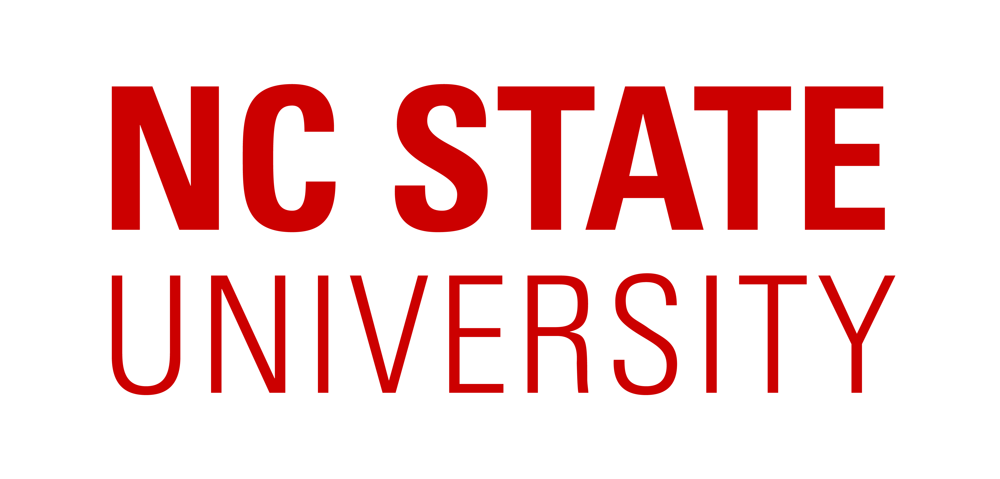

## {#title .title-custom .no-band visibility="uncounted"}

::: {.title-kicker}
ARS 2026 · ANS Winter Conference and Expo
:::

::: {.title-main}
From ADS-IDAC to OpenPRA: Enabling Dynamic Probabilistic Risk Assessment for
Advanced Reactors
:::

::: {.title-rule}
:::

::: {.title-author}
Alp Tezbasaran and Mihai A. Diaconeasa
:::

::: {.title-presenter}
Presenting: **Kirill Shumilov**
:::

::: {.title-inst}
Department of Nuclear Engineering 
Probabilistic Risk Assessment Group 
North Carolina State University
:::

Phoenix, Arizona · November 18, 2026

alptezbasaran.github.io/ars2026

::: {.notes}
Good morning. My name is Kirill Shumilov, and I am presenting work by Alp
Tezbasaran and Mihai Diaconeasa, at NC State.

This talk is about tooling. Dynamic PRA is the right method for advanced
reactors, and the paper shows what it took to turn one dynamic PRA engine,
ADS-IDAC, into a platform that other codes can connect to and that runs at
scale, on its way into OpenPRA.

The slides are online, and the QR code on this slide opens them.
:::














